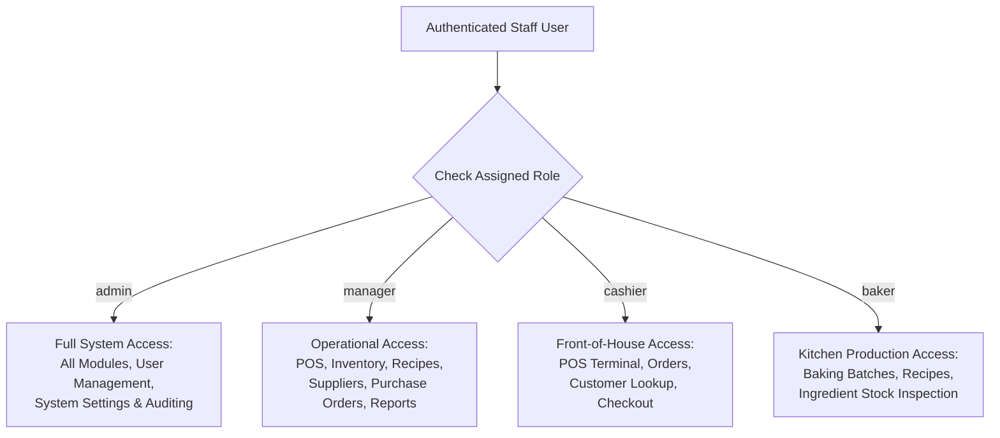

# Project Overview & System Scope
## Moon Cake Bakery Management System

**Academic Course:** Advanced Web Application Development  
**Institution:** [University Name Placeholder]  
**Faculty / Department:** Faculty of Computer Science & Software Engineering  
**Student Name:** [Student Name Placeholder]  
**Student ID:** [Student ID Placeholder]  
**Supervisor / Instructor:** [Instructor Name Placeholder]  
**Academic Year:** 2026–2027  

---

## 1. Problem Statement

Traditional bakery and confectionery enterprises face critical operational bottlenecks when managing daily manufacturing, perishability, and multi-channel counter sales:
1. **Perishability & Shelf-Life Risk:** Fresh bakery goods require tight expiration tracking and shelf-life monitoring to prevent waste and maintain compliance.
2. **Ingredient Consumption Tracking:** Kitchen production involves complex recipes (BOM) where ingredient depletion must be accurately deducted in real-time to avoid production stockouts.
3. **Disjointed Accounting & POS:** Disconnects between front-of-house cash registers and back-office purchasing ledgers cause revenue discrepancies and inaccurate inventory valuation.
4. **Supply Chain Uncertainty:** Ingredients purchased from diverse agricultural suppliers require structured purchase orders with tracked delivery dates to maintain baking schedules.

The **Moon Cake Bakery Management System** resolves these challenges by uniting Point of Sale, recipe formulation, kitchen batch tracking, inventory control, vendor procurement, and financial reporting into an integrated, transaction-safe application.

---

## 2. Project Objectives

- **Operational Efficiency:** Enable cashiers to execute fast, high-volume checkout in under 15 seconds per transaction with support for multi-payment methods.
- **Automated Production & Depletion:** Automatically deduct raw ingredient quantities from warehouse inventory upon completion of baking production batches.
- **Accurate Costing:** Calculate precise unit costs for each bakery item based on ingredient quantities and supplier unit costs.
- **Procurement Management:** Streamline vendor communications, purchase orders, and expected delivery scheduling.
- **Financial Integrity:** Enforce transactional data integrity with zero discrepancy between completed orders, generated sales, and payment collections.
- **Secure Role-Based Access:** Enforce strict role-based authorization across administrators, managers, cashiers, and bakers.

---

## 3. Project Scope

### In-Scope Modules:
- **Point of Sale (POS):** Fast-search product terminal, custom instructions, category filtering, cart management, instant checkout, and print-ready receipt formatting.
- **Order Lifecycle:** In-store order management following the Pickup-Only model (`Pending` → `Preparing / Baking` → `Ready for Pickup` → `Completed` / `Cancelled`).
- **Catalog Management:** Products, categories, product pricing, SKU management, expiration warnings, and shelf-life tracking.
- **Inventory & Ingredients:** Multi-unit ingredient stock levels, low-stock threshold triggers, and real-time stock movement ledgers.
- **Recipe & Formulation Engine:** Standardized recipes, ingredient ratios, and automated production cost calculation.
- **Kitchen Production Batches:** Scheduling baking batches, assigning bakers, and updating production batch states.
- **Supplier Procurement:** Vendor contact management, purchase order generation, and procurement receipt tracking (`expected_delivery_date`).
- **Reporting & Business Analytics:** Daily/monthly sales revenue, top-selling bakery goods, payment method breakdowns, and inventory valuation reports.
- **System Administration:** User management, audit logging, system settings, database backups, and notification management.

### Out-of-Scope (Deliberately Retired):
- **Customer Delivery:** Customer home delivery logistics, driver dispatch, vehicle routing, and third-party delivery integrations have been formally retired in Phase 11.10–11.12 to align with an in-store **Pickup-Only** retail strategy.

---

## 4. System Users & Role-Based Access Control

The application enforces fine-grained authorization using Laravel middleware:

---

## 5. System Limitations & Known Constraints

1. **Pickup-Only Retail Strategy:** The system does not dispatch drivers or track external courier routes. All customer orders are fulfilled via in-store customer pickup.
2. **Auxiliary Role Dashboards:** Two auxiliary role dashboard controllers (`Cashier\DashboardController` and `Manager\DashboardController`) were removed during earlier frontend restructuring; managers and cashiers utilize `/pos` and `/admin` modules directly.
3. **Single-Currency Base:** Financial totals and reports operate under USD base currency as primary accounting denomination.

