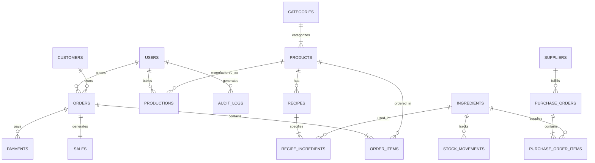

# Database Documentation & Data Dictionary
## Moon Cake Bakery Management System

**Database Product:** PostgreSQL 16.14  
**Active Database:** `bakery_management_system`  
**Total Tables:** Exactly **30 public tables**  
**Encoding:** `UTF8` | Collation: `English_United States.1252`  
**Retired Tables:** `public.deliveries` (formally retired in Phase 11.12)  

---

## 1. Entity-Relationship Architecture

---

## 2. Comprehensive Data Dictionary (All 30 Public Tables)

| # | Table Name | Description | Primary Key | Foreign Keys / Relationships | Active Rows |
| :---: | :--- | :--- | :--- | :--- | :---: |
| 1 | `attendances` | Staff daily clock-in / clock-out attendance. | `id` (bigint) | `user_id` -> `users(id)` | 0 |
| 2 | `audit_logs` | Comprehensive security & audit trail of system activities. | `id` (bigint) | `user_id` -> `users(id)` | 3,219 |
| 3 | `cache` | Laravel cache key-value store. | `key` (varchar) | None | 0 |
| 4 | `cache_locks` | Concurrency lock table for cache atomic locks. | `key` (varchar) | None | 0 |
| 5 | `categories` | Product categorization (Cakes, Breads, Pastries, etc.). | `id` (bigint) | Unique: `name` | 5 |
| 6 | `customers` | Customer profiles and loyalty points tracking. | `id` (bigint) | Unique: `phone` | 4 |
| 7 | `failed_jobs` | Laravel queue failed jobs ledger. | `id` (bigint) | Unique: `uuid` | 0 |
| 8 | `ingredients` | Raw materials warehouse inventory (Flour, Sugar, Butter). | `id` (bigint) | None | 25 |
| 9 | `job_batches` | Queue batch processing table. | `id` (varchar) | None | 0 |
| 10 | `jobs` | Background queue worker job queue. | `id` (bigint) | Index: `queue` | 0 |
| 11 | `migrations` | Laravel database schema migration execution log. | `id` (int) | None | 38 |
| 12 | `notifications` | System and user in-app notifications. | `id` (bigint) | `user_id` -> `users(id)` | 1,355 |
| 13 | `order_items` | Individual line items within customer orders. | `id` (bigint) | `order_id` -> `orders`, `product_id` -> `products` | 23 |
| 14 | `orders` | Master retail customer orders table. | `id` (bigint) | `user_id` -> `users`, `customer_id` -> `customers` | 15 |
| 15 | `password_reset_tokens` | Authentication password reset tokens. | `email` (varchar) | None | 0 |
| 16 | `payments` | Customer payment receipts (cash, card, ABA QR). | `id` (bigint) | `order_id` -> `orders`, `user_id` -> `users` | 15 |
| 17 | `productions` | Daily baking batch schedules and production records. | `id` (bigint) | `product_id` -> `products`, `baker_id` -> `users` | 117 |
| 18 | `products` | Finished bakery items for sale (pricing, shelf life, SKU). | `id` (bigint) | `category_id` -> `categories(id)` | 13 |
| 19 | `purchase_order_items` | Line item ingredients within supplier purchase orders. | `id` (bigint) | `purchase_order_id` -> `purchase_orders`, `ingredient_id` -> `ingredients` | 36 |
| 20 | `purchase_orders` | Supplier procurement orders (includes `expected_delivery_date`). | `id` (bigint) | `supplier_id` -> `suppliers`, `created_by` -> `users` | 33 |
| 21 | `recipe_ingredients` | Bill of materials: ingredient quantities per recipe. | `id` (bigint) | `recipe_id` -> `recipes`, `ingredient_id` -> `ingredients` | 15 |
| 22 | `recipes` | Standardized baking recipes and preparation instructions. | `id` (bigint) | `product_id` -> `products(id)` | 4 |
| 23 | `salaries` | Staff payroll and compensation records. | `id` (bigint) | `user_id` -> `users(id)` | 0 |
| 24 | `sales` | Official double-entry financial sales revenue records. | `id` (bigint) | `order_id` -> `orders`, `user_id` -> `users` | 15 |
| 25 | `sessions` | Web user authenticated session state storage. | `id` (varchar) | Index: `user_id` | 0 |
| 26 | `settings` | Application configuration and bakery business parameters. | `id` (bigint) | Unique: `key` | 22 |
| 27 | `stock_movements` | Auditable ingredient inventory adjustments. | `id` (bigint) | `ingredient_id` -> `ingredients`, `user_id` -> `users` | 196 |
| 28 | `suppliers` | Raw ingredient vendor directory and contacts. | `id` (bigint) | None | 40 |
| 29 | `users` | Staff accounts, credentials, and role assignments. | `id` (bigint) | Unique: `email`, `username` | 20 |
| 30 | `work_schedules` | Employee weekly shift schedules and assignments. | `id` (bigint) | `user_id` -> `users(id)` | 0 |

---

## 3. Financial & Accounting Baseline Verification

The live production database was verified against strict accounting ledger invariants:

| Metric | Recorded Invariant Value | Verification Status |
| :--- | :---: | :---: |
| **Total Orders** | 15 orders | `[VERIFIED]` |
| **Total Sales Volume** | $5,646.43 USD | `[VERIFIED]` |
| **Total Payments Collected** | $5,646.43 USD | `[VERIFIED]` |
| **Outstanding Accounts Receivable** | $0.00 USD | `[VERIFIED]` |
| **Total Purchase Orders** | 33 procurement records | `[VERIFIED]` |
| **Supplier Delivery Tracking** | `purchase_orders.expected_delivery_date` intact | `[VERIFIED]` |

---

## 4. Historical Notifications & Deliveries Table Retirement

1. **Delivery Feature Retirement:**
   - In accordance with the strategic shift to an in-store **Pickup-Only** retail model, the customer delivery table (`public.deliveries`) and its sequence (`deliveries_id_seq`) were dropped in Phase 11.12 via restrictive, transaction-safe DDL (`DROP TABLE public.deliveries RESTRICT;`).
2. **Preservation of Historical Notifications (8 Records):**
   - All 8 historical delivery reminder notifications remain intact:
     * IDs: `565`, `566`, `575`, `576`, `593`, `594`, `707`, `713`
   - Their original action URLs (`http://127.0.0.1:8000/admin/deliveries/{id}`) are intercepted by the application route handler in `routes/web.php` and redirected to `/admin/orders` with an explanatory notification.
