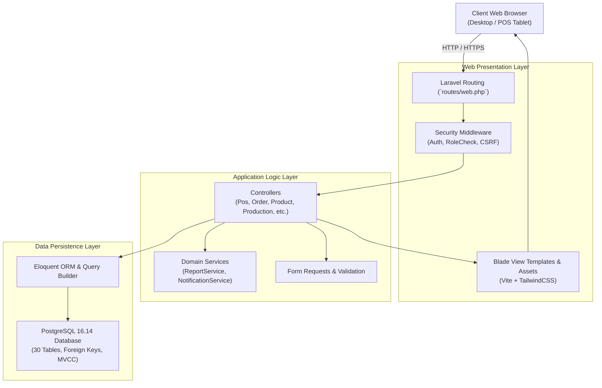
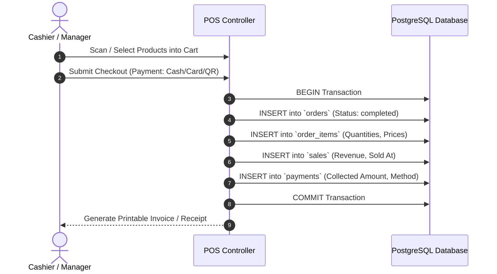
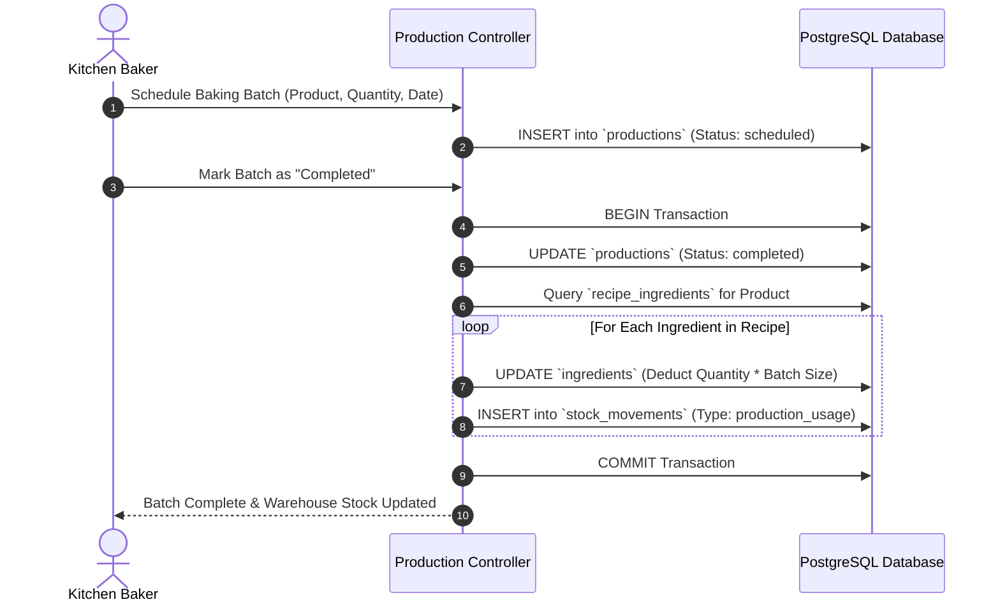

# System Architecture & Technical Specifications
## Moon Cake Bakery Management System

---

## 1. Architectural Overview

The **Moon Cake Bakery Management System** is architected using the standard **Model-View-Controller (MVC)** design pattern, implemented on **Laravel 12 / 13** with **PostgreSQL 16**. The architecture emphasizes high modularity, transactional consistency, and defense-in-depth security.



---

## 2. Directory Structure & Key Components

```
Bakery_Management_System/
├── app/
│   ├── Http/
│   │   ├── Controllers/
│   │   │   ├── Admin/           # Admin management controllers
│   │   │   │   ├── CategoryController.php
│   │   │   │   ├── CustomerController.php
│   │   │   │   ├── DashboardController.php
│   │   │   │   ├── IngredientController.php
│   │   │   │   ├── NotificationController.php
│   │   │   │   ├── OrderController.php
│   │   │   │   ├── ProductionController.php
│   │   │   │   ├── ProductController.php
│   │   │   │   ├── PurchaseOrderController.php
│   │   │   │   ├── RecipeController.php
│   │   │   │   ├── ReportController.php
│   │   │   │   ├── SettingController.php
│   │   │   │   ├── SupplierController.php
│   │   │   │   └── UserController.php
│   │   │   ├── Auth/            # Authentication & Session controllers
│   │   │   ├── PosController.php # POS terminal and checkout controller
│   │   │   └── ProfileController.php # Staff profile management
│   │   └── Middleware/          # Role, password expiry, and security middleware
│   ├── Models/                  # Eloquent models (Order, Sale, Product, etc.)
│   └── Services/                # Business logic services (ReportService)
├── config/                      # Laravel environment configuration
├── database/
│   ├── migrations/              # Database DDL migration files
│   └── seeders/                 # Database seeders
├── resources/
│   └── views/                   # Blade template views
│       ├── admin/               # Administrative views
│       ├── layouts/             # App shell, navigation, header, sidebar
│       └── pos/                 # POS terminal interface
├── routes/
│   ├── web.php                  # Web and application routes
│   └── console.php              # Artisan console command routes
├── storage/                     # Application logs, sessions, and backups
└── tests/                       # Automated PHPUnit feature & unit test suites
```

---

## 3. Core Domain Workflows

### 3.1 Point of Sale & Checkout Workflow


### 3.2 Recipe Formulation & Baking Production Batch Workflow


---

## 4. Security Architecture

1. **Authentication:** Native Laravel session guard utilizing bcrypt password hashing with automatic password expiration enforcement (`EnsurePasswordNotExpired`).
2. **Role Authorization (`CheckRole`):** Strictly intercepts requests based on role declarations (`admin`, `manager`, `cashier`, `baker`).
3. **Cross-Site Request Forgery (CSRF):** Protected via encrypted tokens generated on every state-changing POST/PUT/DELETE request.
4. **SQL Injection Prevention:** 100% parameterized queries via Eloquent ORM and PDO binding; zero raw unescaped input interpolation.
5. **Historical URL Fallback Interceptor:** Route handler intercepts obsolete `/admin/deliveries/{id}` URLs and redirects authenticated requests gracefully to `/admin/orders` with an informational flash alert.
